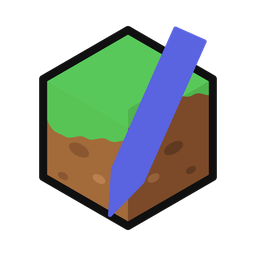

# MC Asset Studio

本项目是一个面向 Windows 10/11 x64 的 Minecraft Java Edition 资源包工作台，采用 C++20 与 Qt 6 Widgets 构建。

本项目为非官方社区工具，主要用于浏览、编辑和导出 Minecraft Java 资源包：

- 扫描多个 `.minecraft` 根目录和版本隔离实例；
- 识别 Forge / NeoForge / Fabric / Quilt 模组，并按命名空间归类材质；
- 对只替换材质的资源包，从参考实例/客户端 jar 回退 blockstates、models、lang 等文件；
- 像素编辑器、动画时间轴、`.mcmeta` 编辑；
- 材质墙、集合模式、检查器、主题和 Windows 11 原生控件样式；
- 导出 ZIP 或覆盖原资源包，不修改参考资源。

> 本项目与 Mojang Studios 或 Microsoft 没有隶属关系。Minecraft 是 Mojang Synergies AB 的商标。请参阅下方“免责声明”。

> [!IMPORTANT]
> **AI 辅助开发声明**
>
> 本项目采用 **AI Coding（AI 辅助编程）** 方式开发，主要使用 **DeepSeek** 系列模型辅助完成代码编写、重构、文档撰写与问题排查。所有 AI 生成或修改的内容均经过维护者的人工审查、修改、构建验证和必要测试；维护者对最终代码、文档及发布内容负责。详见下文“开发方式与 AI 辅助声明”。



## 开发方式与 AI 辅助声明

本项目采用 **AI Coding（AI 辅助编程）** 方式进行开发。开发过程中主要使用 **DeepSeek** 系列模型作为编程助手，用于代码草拟、重构建议、文档撰写、问题定位与测试辅助。

AI 工具仅作为开发辅助手段。所有由 AI 生成或修改的内容均经过维护者的人工审查、修改、构建验证与必要的运行测试；维护者对最终代码、文档及发布内容承担责任。

使用 AI 辅助工具不影响本项目源代码的 MIT 许可证，也不改变第三方组件（包括 Qt）的授权条件。DeepSeek 是其权利人的商标，此处仅用于客观说明开发工具。

## 功能

### 游戏环境与参考资源

- 多 `.minecraft` 根目录；每个根目录独立缓存。
- 扫描 `versions/<id>`、版本 JSON、继承链、实例 `mods/` 和 `resourcepacks/`。
- 识别 Forge、NeoForge、Fabric、Quilt 及核心模组元数据。
- 资源包只包含材质时，按 `pack_format` / `supported_formats` 匹配参考实例。
- 分层只读资源栈：

```text
pack/ 覆盖层 → source/ → 参考 mod jar → 客户端 jar → assets objects
```

### 编辑

- 材质墙按模组、类型、来源筛选；双击材质卡片打开像素编辑器。
- 钢笔、橡皮、油漆桶、吸管、直线、矩形、椭圆、选区移动/复制/粘贴。
- 颜色、透明度、笔刷大小、连续区域填充、容差、对称、网格、洋葱皮、缩放/平移。
- 本图颜色板 + HSV 色轮、收藏/最近颜色、颜色替换、手动合并颜色、减少颜色（2–256 色）。
- 模板库：ZIP/散装 PNG、一键从参考实例/原版 jar 提取铁锭/装备/工具/宝石/粗矿等灰度模板；支持整套装备模板批量写入 `pack/`。
- 调色：渐变颜色带 + 明暗曲线、预设、强度、方向渐变、套索/魔棒蒙版、当前帧/所有帧、配方保存/载入、一步撤销。
- 视图：×2/÷2、平铺预览、可拖动布局、参考图、独立窗口/专注模式。
- 动画：垂直帧条、逐帧 `time`、默认 `frametime`、`interpolate`、播放预览。
- 保存时写入 `pack/`，参考 jar 和 `source/` 保持只读；手动 `Ctrl+S` 保存。
- `.mcmeta` 保留未知字段；删除动画时保留首帧并保留 `gui` / `blur` 等字段。

### 界面

- 材质墙 / 集合模式 / 检查器 / 项目概览 / `pack.mcmeta` 编辑。
- 主题：跟随系统深/浅色、Windows 11 原生、10 套配色。
- 控件样式：Fusion、Windows 11、Windows Vista/7、Windows 经典。

> 为避免在公开仓库中分发 Minecraft/模组材质，源码仓库**不包含界面截图**。截图只应使用自己制作的示例材质，或放在 GitHub Release 中并注明第三方素材归属。

## 环境要求

- Windows 10/11 x64
- Visual Studio 2022 或 2026，安装“使用 C++ 的桌面开发”
- Qt 6.12 MSVC 2022 64-bit，包含 Qt Core / Gui / Widgets
- CMake >= 3.24
- Git（可选，用于克隆仓库）

项目使用 `QZipReader` / `QZipWriter`（Qt Core 私有 API），因此需要 Qt 的 private headers；当前锁定 Qt 6.12 构建，升级 Qt 前请先验证。

## 从源码构建

### 方式一：CMake Presets

```powershell
$env:QTDIR = "C:\Qt\6.12.0\msvc2022_64"

cmake --preset windows-msvc
cmake --build --preset release
```

如果使用 Visual Studio 2026：

```powershell
cmake --preset windows-msvc-2026
cmake --build build/windows-msvc-2026 --config Release --target MCStudio
```

产物：

```text
build/windows-msvc/bin/Release/MCStudio.exe
```

### 方式二：直接使用 CMake

```powershell
$env:QTDIR = "C:\Qt\6.12.0\msvc2022_64"

cmake -S . -B build -G "Visual Studio 17 2022" -A x64 `
  -DCMAKE_PREFIX_PATH="$env:QTDIR"
cmake --build build --config Release --target MCStudio
```

### 方式三：仓库脚本

```bat
set QTDIR=C:\Qt\6.12.0\msvc2022_64
scripts\build.bat
```

脚本默认使用 Visual Studio 2022；其他版本可设置：

```bat
set MCSTUDIO_CMAKE_GENERATOR=Visual Studio 18 2026
scripts\build.bat
```

## 运行

```bat
scripts\run.bat
```

或直接运行：

```text
build\windows-msvc\bin\Release\MCStudio.exe
```

首次启动会在程序目录创建 `data\`；如果安装目录不可写，则回退到 `%LOCALAPPDATA%` 下的应用数据目录。

## 使用方法

### 1. 新建 / 打开项目

- **新建项目**：选择目标 `pack_format`，创建空白资源包。
- **打开项目**：选择已有项目目录或已有资源包。
- **导入 ZIP / 文件夹**：导入后复制到 `data/projects/`，原 ZIP/文件夹保持不变。

### 2. 添加游戏目录（可选）

打开 `编辑 → 首选项… → 游戏目录`，添加 `.minecraft` 根目录或实例目录。  
参考实例用于从客户端 jar 或模组 jar 读取模型、blockstates、语言文件和材质。

### 3. 浏览材质

- 左侧按资源类型/模组筛选，顶部搜索按路径过滤。
- 材质墙可切换“全部 / 仅包内 / 仅参考”。
- 蓝色/橙色徽标区分包内材质与参考材质。
- 双击材质卡片进入像素编辑器；右键可查看大图或导入参考材质到 `pack/`。

### 4. 编辑与保存

- 使用左侧工具编辑像素；右侧调整颜色、透明度、笔刷、填充、对称、网格和洋葱皮。
- 动画贴图在底部时间轴编辑：创建动画、拆分垂直帧条、添加/删除/移动帧、设置逐帧时间。
- `Ctrl+S` 或“保存”写入 `pack/`；未保存标签会显示 `*`。
- 关闭标签/切换项目/退出时会提示保存、放弃或取消。

### 5. 导出

- 项目概览中可导出为新 ZIP，或按项目设置覆盖原 ZIP。
- 参考材质不会自动进入导出；只有 `pack/` 覆盖层会被写入。
- 导出前建议先在游戏中验证贴图尺寸和动画 `.mcmeta`。

## 数据与隐私

```text
data/
  settings.ini       # 界面、主题、最近项目、游戏目录
  projects/          # 项目工作副本、source/、pack/、缓存
  game/              # 游戏目录扫描缓存
  cache/             # 关联缓存
```

- `data/` 不进入仓库、不进入发布包。
- 程序不包含遥测，不主动上传项目、材质或游戏目录信息。
- 参考 jar、客户端 jar 和 `source/` 只读；编辑只写入 `pack/`。

## 打包

```bat
scripts\package.bat
```

打包脚本使用 `windeployqt` 复制 Qt 运行库，并排除 `dist\MCStudio\data`。发布二进制前请确认 Qt 许可证和 `LICENSES/`、`NOTICE` 已一起分发。

## 目录结构

```text
src/core/       资源栈、ZIP、项目、扫描、像素/动画文档
src/ui/         主窗口、材质墙、集合、检查器、像素编辑器、主题
src/app/        Win32 入口与 Qt 初始化
resources/      QSS、图标、manifest、Windows 资源
scripts/        构建、运行、打包
docs/           架构文档
```

架构细节见 [docs/ARCHITECTURE.md](docs/ARCHITECTURE.md)。

## 已知限制

- 仅支持 Windows；没有 Linux/macOS 构建。
- 3D 预览仍是后续阶段。
- 依赖 Qt 6.12 私有 Core API；Qt 升级可能导致编译失败。
- 当前没有自动化测试；CI 只保证 Windows Release 可构建。
- 首次扫描大型整合包可能较慢；后续使用缓存。

## 许可证

- 本项目**自己的代码**采用 [MIT License](LICENSE)。
- Qt 6.12 采用 **LGPL-3.0**（详见 [NOTICE](NOTICE)、[LICENSES/LGPL-3.0-only.txt](LICENSES/LGPL-3.0-only.txt)）。
- Qt 动态链接；发布二进制时需保留可替换的 Qt DLL，并附带 Qt 版权声明、LGPL 文本和对应源码获取方式。
- 如果使用 GPL 版 Qt，整个程序必须按 GPL-3.0 发布；如果使用商业 Qt，按商业协议处理。
- `docs/` 中的截图不属于 MIT 授权（本公开仓库默认不包含截图）；第三方材质、模组和游戏资源归各自权利人所有。

> 维护者备注：本仓库按 **Qt LGPLv3** 准备。发布二进制前必须确认实际 Qt 授权；如果你使用的是 GPL 版 Qt，请把项目许可证改为 GPL-3.0。

## 免责声明

```text
MC Asset Studio is an unofficial community project.

Not an official Minecraft product. Not approved by or associated with
Mojang Studios or Microsoft. Minecraft is a trademark of Mojang Synergies AB.

This project does not include Minecraft client jars, mod jars, resource packs,
or game assets. It only reads files from installations selected by the user.
```

本项目按“现状”提供，不附带任何明示或暗示担保。使用前请备份资源包和项目；作者不对数据丢失、游戏崩溃或第三方素材版权问题承担责任。

## 贡献

欢迎提交 issue 和 pull request。请先阅读 [CONTRIBUTING.md](CONTRIBUTING.md)。

- 不要提交 Minecraft 客户端、模组 jar、资源包或游戏材质。
- 新增代码请保持 C++20/Qt Widgets 风格，并在 Windows Release 下构建通过。
- 提交代码即表示同意以 MIT License 授权你的贡献。

## 安全

请勿在 issue 中粘贴包含个人信息、游戏账号、绝对路径或未公开项目内容的日志。安全问题请按 [SECURITY.md](SECURITY.md) 私下报告。

## 致谢

- Qt 6 / The Qt Company
- Minecraft 资源包格式与社区工具生态
- 所有提交 issue、测试和反馈的贡献者
